<!-- ═══════════════════════════════════════════════════════════════════
     KARTHIKEYA MUDILI · GITHUB PROFILE README
     Repo: karthikeyamudili/karthikeyamudili (public, special repo)
     All SVGs in ./assets/ are self-contained: system fonts, no external
     images, no scripts. Motion is CSS/SMIL only and static-safe.
     Project links are colored button badges; layout stacks on mobile.
     Privacy: no phone number anywhere. Only the public email below.
════════════════════════════════════════════════════════════════════ -->

  

  
  
  
  
  
  

### ↗ Jump straight into the work

**01 · The Strategic Evolution of Keppel Ltd. (1968–2026)**  
Longitudinal corporate-strategy research — Keppel's shift from state shipyard to global asset manager.

  
  
  

---

**02 · Interactive Portfolio & Grounded AI Recruiter**  
SVG-crafted site with a deterministic, hallucination-free recruiter chatbot.

  
  

---

**03 · CS50P Python & Mathematical Modeling**  
Ongoing quantitative lab — first published artifact: DBS Loan Amortization Engine.

  
  

<!-- Optional: once your contribution history grows, uncomment this block
     for a live, genuine burgundy activity graph (real GitHub data only):

### 📈 Contribution activity — live GitHub data

-->

  Designed &amp; hand-built in Visakhapatnam · burgundy editorial system · static-safe SVG · no fake metrics

