<!-- ═══════════════════════════════════════════════════════════════════
     KARTHIKEYA MUDILI · GITHUB PROFILE README
     Repo must be PUBLIC and named exactly: karthikeyamudili/karthikeyamudili
     All SVGs in ./assets/ are self-contained (system fonts, no external
     images, no scripts). Motion is CSS/SMIL only and static-safe.
     Privacy: no phone number anywhere. Only the public email below.
════════════════════════════════════════════════════════════════════ -->

  

  
  
  
  
  
  

### ↗ Jump straight into the work

| # | Project | Evidence & links |
|:-:|:--------|:-----------------|
| 01 | **The Strategic Evolution of Keppel Ltd. (1968–2026)** — longitudinal corporate-strategy research | [SSRN paper (DOI)](https://doi.org/10.2139/ssrn.6196159) · [SSRN author page](https://ssrn.com/author=10281216) · [ORCID iD](https://orcid.org/0009-0008-2440-8170) |
| 02 | **Interactive Portfolio & Grounded AI Recruiter** — SVG-crafted site with a deterministic, hallucination-free chatbot | [Live portfolio](https://karthikeyamudili.github.io) · [Source code](https://github.com/karthikeyamudili/karthikeyamudili.github.io) |
| 03 | **CS50P Python & Mathematical Modeling** — ongoing quantitative lab; first published artifact: DBS Loan Amortization Engine | [Zenodo DOI record](https://zenodo.org/records/18526916) · [GitHub profile](https://github.com/karthikeyamudili) |

### 📈 Contribution activity — live, genuine GitHub data

<!-- Real data from the activity-graph service. If it ever rate-limits or
     breaks, remove this block — never replace it with fabricated activity. -->

  
<b>Prefer plain text? Quick profile summary (mobile & screen-reader friendly)</b>

   

  **VDNSS Karthikeya Mudili** — Visakhapatnam & Rajahmundry, Andhra Pradesh, India.

  - 🎓 1st-year **B.Sc. (Honors) Mathematics**, upcoming Computer Science minor — Dr. Lankapalli Bullayya Degree College, Visakhapatnam
  - 🧮 Intermediate (MEC): **95.8%** · Class 10 (ICSE): **88.6%**, St. Ann's School, Rajahmundry
  - 📊 **ICAI CA Foundation — cleared in 1st attempt (2023)**
  - 📝 Research: *The Strategic Evolution of Keppel Ltd. (1968–2026)* — [SSRN](https://ssrn.com/author=10281216) (31+ downloads, snapshot count) · Python FinTech model on [Zenodo](https://zenodo.org/records/18526916) · [ORCID](https://orcid.org/0009-0008-2440-8170)
  - 🛠️ Building: AI command engineering, interactive HTML/CSS/JS, Python via **Harvard CS50P** (active), MATLAB Onramp
  - 🌐 [Portfolio](https://karthikeyamudili.github.io) · [LinkedIn](https://www.linkedin.com/in/karthikeya-mudili) · [Email](mailto:karthikeyamudili@gmail.com)

  Designed &amp; hand-built in Visakhapatnam · burgundy editorial system · static-safe SVG · no fake metrics

